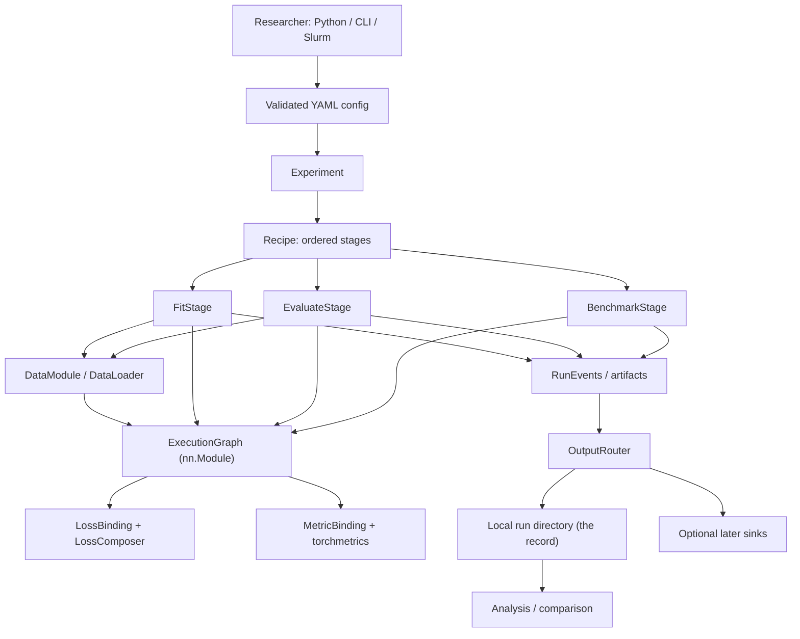
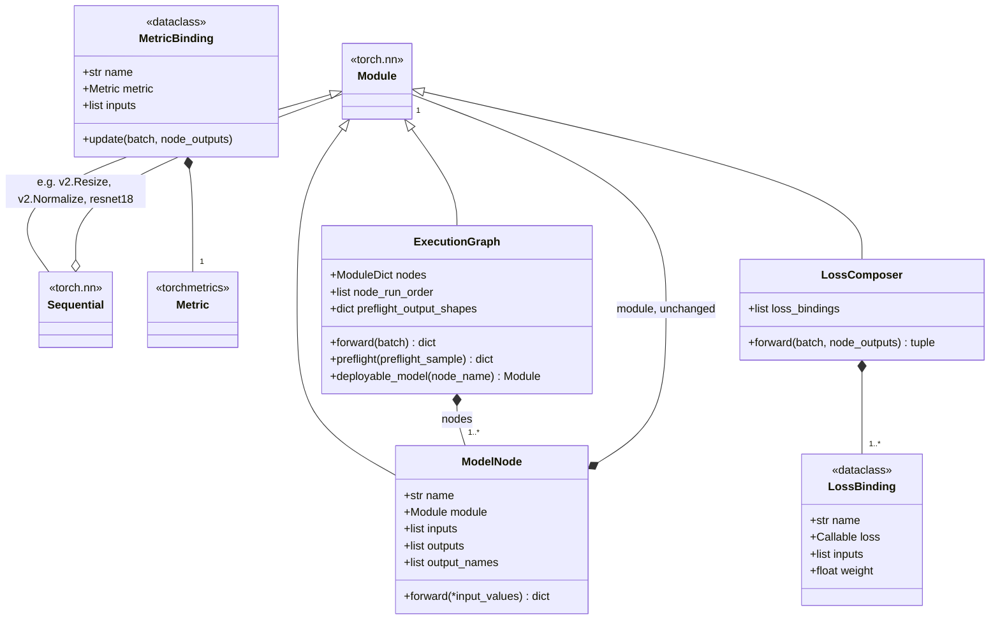
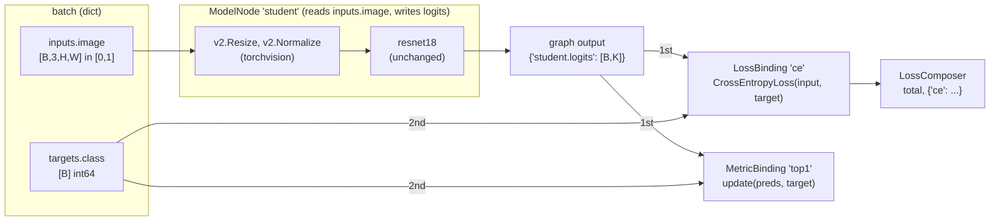
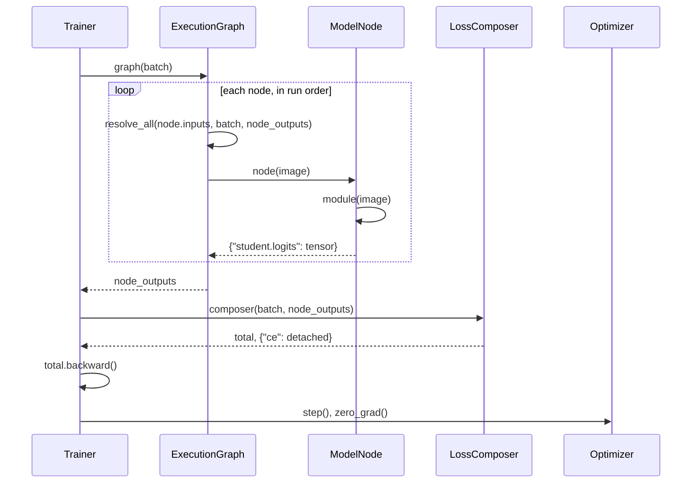
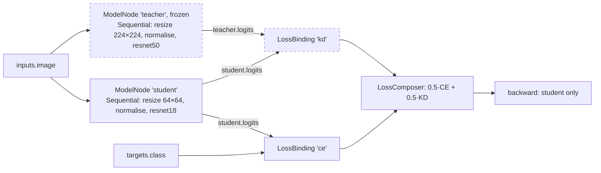
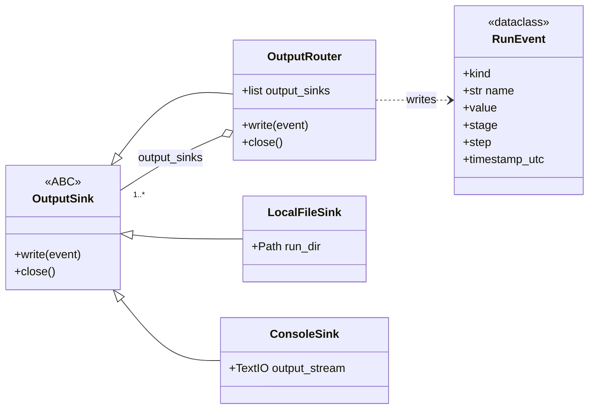

# CS407: Modular PyTorch Research Pipeline — Implementation Plan

**Version:** 1.1  
**Date:** 17 November 2026  
**Status:** Ready for team review. Items marked _Provisional_ must be confirmed in Phase 0.  
**Audience:** Researchers and coding agents building the repository.  
**First objective:** a working, end-to-end classification prototype on ImageNet-style data with **one model**, before any compression research features.

> **For an implementing agent:** Build **in phase order**. Do not start a phase while the previous phase's acceptance tests fail. Treat the public interfaces, the import rules (§1, §4) and the tests as requirements. Where this plan is silent, choose the smallest plain-PyTorch solution and record the choice in `docs/decisions.md`, rather than adding an abstraction early. Code in this plan shows the intended API; none of it exists yet.

---

## 0. Background and goals

CS407 studies efficient models for computational pathology: **knowledge distillation (KD), quantisation, pruning and tile selection**. It needs swappable teacher and student models, **zero, one or several teachers**, classification and later segmentation, measurement of both accuracy and real inference cost, and later TIAToolbox integration. The specification starts with an ImageNet/ResNet prototype, moves on to pathology foundation models, and evaluates combined optimisations (accuracy against parameters, size, FLOPs, latency, throughput and peak memory).

This plan merges those requirements with the earlier `alternative-plan.zip` and the design discussion that followed it:

- **Kept:** stage-based runs, per-model preprocessing, explicit adapters, reproducibility, saved stage outputs, torchmetrics, configurable output destinations, plain-Python use, synthetic smoke tests, later caching of teacher outputs, and fair benchmarks.
- **Changed:** a model's computation is a small **graph of named steps**, not a fixed "model + teachers" bundle; losses and metrics read their inputs **by name**, not from a shared global object; each technique plugs in at **the stage where it acts**, with optional bundles later.
- **Deferred:** a general distributed graph engine, multi-GPU training, full workflow caching, dashboards, automatic adapter design, FPGA deployment, full WSI processing, and all advanced optimisations, until the baseline works.

### Goals

1. A researcher can write a standard `torch.nn.Module` and train or run it with **no experiment setup**.
2. The same model can run as a small reproducible experiment (`Fit → Evaluate → Benchmark`) that saves its results automatically.
3. Someone else can later add a loss, metric, adapter, optimisation or dataset **without editing the trainer**.
4. A run can evaluate and benchmark **between** compression steps, so the effect of each step can be measured.
5. Slurm array jobs can run configs independently, but the core code never depends on Slurm.
6. The deployable model stays an ordinary `nn.Module`, ready for a later TIAToolbox wrapper.

### Scientific rules (from day one)

- The final test set is never used for model selection, tuning or early stopping.
- Every prediction and metric is tied to the right unit: image, tile, slide, patient or pixel.
- A student's measured inference cost never includes a frozen teacher or a training-only projector.
- Low-bit speed-up claims need **real supported kernels and measured timings**. Simulated ("fake") quantisation shows accuracy only, not speed.
- For every comparison, record input size and normalisation, splits, checkpoints, seed and numeric precision.
- Splits must keep **patients** separate before any pathology experiment.

---

## 1. Architecture overview

There are two graphs, at two levels:

- **Recipe:** an ordered list of _stages_, each a whole operation: `Fit`, `Transform`, `Evaluate`, `Benchmark`, `Export`. A stage reads saved artifacts and produces new artifacts and measurements. Phase 1 needs only `Fit`, `Evaluate` and `Benchmark`.
- **ExecutionGraph:** the computations inside **one forward pass**, as a graph without loops (a DAG). Each step, a _node_, is a PyTorch module: a ResNet, a ViT, a feature projector, a tile selector. A single model is a **one-node graph**; KD adds nodes.

**Terms used throughout**

| Term      | Meaning                                                                                                     |
| --------- | ----------------------------------------------------------------------------------------------------------- |
| Name      | A dotted name for one value: a batch value (`inputs.image`) or a node output (`student.logits`).            |
| Binding   | A loss or metric plus the names of the values it reads, in argument order, e.g. `["student.logits", "targets.class"]`. |
| Interface | The declared inputs, outputs and behaviour of a component.                                                  |
| Registry  | A fixed table from a name in a config (`"resnet18"`) to the code that builds it.                            |
| Adapter   | A small module that changes a value's form at a boundary (resize and normalise; project features).          |
| Sink      | A destination for results (local files, console). Code emits results without knowing where they are stored. |
| Artifact  | A saved file a stage produces (checkpoint, weights, metrics), referred to by an explicit reference.         |

**Combine objects; don't subclass per combination.** New behaviour comes from combining ordinary PyTorch objects, not from a subclass for each mix of techniques. _Why:_ with $n$ techniques, subclasses for every mix grow like $2^n$; combinable objects grow like $n$.



**Import rule:** `core`, `data`, `models`, `training` and `evaluation` never import the CLI, Slurm or the experiment runner. Higher layers use lower ones, never the reverse. TIAToolbox and TRIDENT code lives in `integrations/` and is not needed to import or test the core. _Why:_ the core then works from a notebook and is testable on a laptop.

### Ways to use the code (all must keep working)

| Level                   | Typical use                                                                      | Needs                                       |
| ----------------------- | -------------------------------------------------------------------------------- | ------------------------------------------- |
| 0 — plain PyTorch       | `model(x)`, custom training or debugging                                         | PyTorch only                                |
| 1 — reusable components | `graph(batch)`, `Trainer().fit(graph, loader, ...)`, `Evaluator().evaluate(...)` | Core package only; **no Recipe/Experiment** |
| 2 — reproducible run    | `python -m lwfm.run --config ...`                                                | Config, Recipe, run directory               |
| 3 — batch experiment    | Slurm array, later Hydra/Submitit                                                | Same Level 2 command, one config per task   |

---

## 2. Decisions and assumptions

Agents implement these defaults unless the team changes them in Phase 0. They are not claims about existing code.

| ID  | Decision               | Default and reason                                                                                                         | Status                                          |
| --- | ---------------------- | -------------------------------------------------------------------------------------------------------------------------- | ----------------------------------------------- |
| D01 | Package                | `lwfm` package at the repository root (no `src/` folder)                                                                   | **Provisional:** rename if the team prefers     |
| D02 | Python/PyTorch         | A Python version the **actual cluster** supports, with a matching locked PyTorch/torchvision/torchmetrics set              | **Verify on DCS**; do not hard-code Python 3.14 |
| D03 | Building blocks        | `torch.nn.Module`, `Dataset`/`DataLoader`, `torch.optim.Optimizer`, `torchmetrics.Metric`; nothing else                    | Accepted                                        |
| D04 | Data format            | Nested dict `{"inputs": ..., "targets": ..., "meta": ...}`; numbers are `Tensor`s. Torch tools already handle dicts (§3.1) | Accepted                                        |
| D05 | Model wrapping         | The raw `nn.Module` is never changed; `ModelNode` names the values it reads and writes                            | Accepted                                        |
| D06 | Forward graph          | A small graph fixed at build time; nodes stored in `nn.ModuleDict`; no rewriting while running                             | Accepted                                        |
| D07 | Losses and metrics     | Ordinary callables, `nn.Module`s or torchmetrics objects, each with **named input bindings**                               | Accepted                                        |
| D08 | Training loop          | A short, readable, single-device `Trainer` in plain PyTorch; no Lightning                                                  | Accepted                                        |
| D09 | Technique entry points | Separate `DataTransform`, `ModelTransform`, graph node, `LossBinding`, `Callback`; an optional `Technique` bundle later    | Accepted                                        |
| D10 | Run steps              | `Recipe` = ordered `Stage`s, each returning a `StageResult` with explicit artifact references                              | Accepted                                        |
| D11 | Config                 | **Phase 1:** safely parsed YAML with typed validation. **Later:** Hydra/Submitit if shown to be compatible                 | Accepted                                        |
| D12 | First dataset          | **Synthetic FakeData first**, then an **ImageNet-style `ImageFolder` subset** (e.g. ImageNet-100)                          | Needs local data; nothing is downloaded         |
| D13 | Preprocessing          | Shared training augmentation per sample, then resize/normalise per model; never apply a transform twice                    | Accepted                                        |
| D14 | Evaluation split       | Train/validation from a fixed manifest; official ImageNet val kept as the final test set if available                      | Accepted                                        |
| D15 | Tracking               | Local run directory with JSON/JSONL is the record; remote trackers optional                                                | Accepted                                        |
| D16 | Compute                | CPU smoke runs locally, optional GPU; one GPU per Slurm task; cluster features checked separately                          | Accepted                                        |
| D17 | Benchmarks             | **Quality** and **cost** measured separately; report the protocol and a hardware fingerprint                               | Accepted                                        |
| D18 | TIAToolbox             | A later wrapper around the final deployable model; no TIAToolbox dependency in Phase 1                                     | Accepted                                        |
| D19 | Teacher outputs        | Teacher runs live first; saved (offline) teacher outputs later, keyed by sample and view                                   | Accepted                                        |
| D20 | FPGA/Rust/multi-GPU    | Not in the first version; consider only after profiling shows a real bottleneck                                            | Accepted                                        |

### Phase 1 assumptions

- Inputs are **RGB classification** images. Top-5 is computed only when `num_classes >= 5`.
- `inputs.image` holds float CHW tensors in `[0, 1]`. Per-model resizing and normalisation happen **exactly once**, as the first steps of the model's `nn.Sequential`: torchvision's `v2.Resize` and `v2.Normalize`, or any other `nn.Module` the user chooses. lwfm has no preprocessing class of its own. `ImageFolder` decodes on CPU. Original image sizes may differ.
- Targets are zero-indexed integer class IDs in `[0, K)`, as `torch.long`.
- The ImageNet-style folder groups images by class name, with **one frozen class-name-to-index map** shared by every split. Never build a separate map per split.
- Phase 1 needs no full ImageNet-1k download or pretraining. The team supplies a properly licensed folder dataset. Synthetic data proves the code runs; it supports **no accuracy claim**.
- The first benchmark reports **CPU or CUDA inference latency**, parameter count and model size. FLOPs, energy and WSI latency come later.
- One process, one device (CPU or one GPU). No distributed training.
- Only **classification** is accepted. Segmentation and WSI inputs are planned extensions and must not be squeezed into classification.

---

## 3. Public interfaces

These live in `lwfm/` (mostly `core/`), and tests pin their behaviour. Signatures here are the target API. Names or types may be refined only if behaviour stays the same and the tests are updated.

§3.1–3.4 cover the **graph building blocks**: the minimum needed for one node that takes a batch of images and returns class scores. §3.5–3.9 cover the services built on top of them.

### 3.1 Batches and names

A batch is a **plain nested dict**:

```python
from typing import Any

type Sample = dict[str, Any]
type Batch = dict[str, Any]  # {"inputs": {...}, "targets": {...}, "meta": {...}}
type Name = str  # "inputs.image" (from the batch) or "student.logits" (from a node)

batch = {
    "inputs": {"image": images},  # float32 [B, 3, H, W] in [0, 1]
    "targets": {"class": labels},  # int64 [B]
    "meta": {"sample_id": sample_ids},  # list[str], length B
}
```

_Why a dict and not a custom class:_ the default `DataLoader` collate, `.to()` helpers, `torch.save` and tracing tools already handle dicts. A custom container would need support written for each of them.

**Names** are how nodes, losses and metrics say which values they read. There are two kinds:

- `<group>.<key>` is a batch value, where the group is `inputs`, `targets` or `meta`: `"inputs.image"` means `batch["inputs"]["image"]`.
- `<node>.<output>` is an output of a node that ran earlier: `"student.logits"`. A node only ever writes under its own name.

The graph returns a **flat** dict keyed by name, so every value has exactly one name.

_Why string names:_ the wiring is visible in one place, survives being written to YAML and logs, and lets a new loss or node use existing outputs without any code that knows about it.

Later tasks **add** keys and never rename them: segmentation adds `targets.mask` `[B, H, W]`; slide-level data adds `inputs.features` `[B, N, D]`, `inputs.coords` `[B, N, 2]` and `inputs.valid_tiles` `[B, N]`. Variable-length examples get their own collate function, not new top-level groups.

**Helpers:**

- `validate_batch(batch, required_fields, task)` checks keys, tensor ranks, label types and matching batch sizes, with clear error messages.
- `move_to_device(obj, device)` moves **only tensors** inside nested dicts/lists/tuples; strings and metadata are kept; `non_blocking` optional.
- `classification_collate(samples)` stacks tensors and lists metadata; its tests include non-tensor metadata.
- Never create GPU tensors inside `Dataset` worker processes; the trainer and evaluator move batches to the device.

### 3.2 Graph building blocks

**Straight chains are plain torch; the graph is only for branches.** Anything that runs one step after another (preprocessing then a model, a backbone then a head) is an ordinary `nn.Module`, usually `nn.Sequential(...)`. `ExecutionGraph` is needed only where values **branch or merge**: a teacher and a student reading the same image, a projector reading the student's features, a loss reading two outputs. _Why:_ `nn.Sequential` already handles registration, `.to()`, `state_dict()`, indexing and slicing, so re-implementing chains in the graph would add code and nothing else.

Phase 1 needs five objects. Three of them **are** `nn.Module`s, so `.parameters()`, `.to()`, `.train()`, `.eval()`, `state_dict()` and autograd work on them with no extra code. The other two are dataclasses that pair an existing torch or torchmetrics object with the names it reads.

**Class diagram (Phase 1)**



Read it as: a graph **holds** nodes; a node **holds** one untouched module, often an `nn.Sequential` of preprocessing transforms then the model; a composer **holds** loss bindings; a metric binding **holds** one torchmetrics metric. Nothing inherits from anything except `nn.Module`. One function, `resolve_all(names, batch, outputs)` (not drawn), turns names into values; the graph, the composer and the metric bindings all call it, so a name means the same thing everywhere.

| Object           | Is a        | Job                                                                                  | Why it exists                                                                                          |
| ---------------- | ----------- | ------------------------------------------------------------------------------------ | ------------------------------------------------------------------------------------------------------ |
| `ModelNode`      | `nn.Module` | Passes its `inputs` to its module, in order; stores what it returns under its `outputs` | Any model works as-is, whatever its argument names or return type (Tensor, tuple or dict).       |
| `ExecutionGraph` | `nn.Module` | Runs nodes in dependency order; returns `{name: Tensor}`                             | One class serves 1 node now and $n$ nodes later, so KD needs no second execution path.                 |
| `LossBinding`    | dataclass   | Pairs a loss with the values it reads and a weight                                   | `nn.CrossEntropyLoss` is used unwrapped; only the wiring is new.                                       |
| `LossComposer`   | `nn.Module` | Computes $\mathcal{L} = \sum_i w_i \ell_i$ and per-term logs                         | Adding a loss term (KD, regulariser) is one more list entry, not a trainer change.                     |
| `MetricBinding`  | dataclass   | Pairs a torchmetrics metric with the values it reads                                 | The same metric can score the student or a teacher by changing one name.                               |

**One forward pass of the single-node graph**



The box inside the node is one `nn.Sequential`; the graph sees it as a single module.

**Who calls what in one training step**



**API (implemented).** The code is in `lwfm/`, with tests in `tests/unit/` and runnable examples in `examples/building_blocks.ipynb`. The code is the reference; this summary only says what each piece accepts.

| Where                        | Signature                                                                       | Notes                                                                                                                  |
| ---------------------------- | ------------------------------------------------------------------------------- | ---------------------------------------------------------------------------------------------------------------------- |
| `lwfm/core/names.py`         | `resolve(value_name, batch, node_outputs)`, `resolve_all(value_names, batch, node_outputs)`           | Raises `UnknownNameError` (a `KeyError`) naming the missing value.                                                     |
| `lwfm/core/graph.py`         | `ModelNode(name, module, inputs, outputs)`                                        | `inputs`/`outputs` take one name or a list. Node names can't contain `.` or be `inputs`, `targets` or `meta`.            |
|                              | `ExecutionGraph(nodes, preflight_sample=None)`; `graph(batch) -> {name: Tensor}`          | Raises `GraphError` at build time for duplicate names, unknown reads and cycles. Given a `sample` batch, then runs `preflight(preflight_sample)`; output shapes in `graph.preflight_output_shapes` (`None` without a sample). |
|                              | `graph.preflight(preflight_sample) -> {name: shape}`                                      | Runs the graph once on `sample` (any batch on the graph's device, even zeros). Eval mode, no gradients, mode restored; every output must keep the batch size as its first dimension. |
|                              | `graph.deployable_model(node_name) -> nn.Module`                                     | The named node's module itself, sharing weights. No default: the graph doesn't know which node is the student.         |
| `lwfm/core/losses.py`        | `LossBinding(name, loss, inputs, weight=1.0)`; `LossComposer(loss_bindings)`          | `composer(batch, node_outputs) -> (total_loss, {name: detached loss term})`; raises `ValueError` for a non-finite or non-scalar loss.  |
| `lwfm/evaluation/metrics.py` | `MetricBinding(name, metric, inputs)`; `binding.update(batch, node_outputs)`          | `metric` is a torchmetrics `Metric`.                                                                                   |
| `lwfm/evaluation/evaluator.py` | `Evaluator().evaluate(graph, data_loader, metric_bindings, *, device, split_name="val", output_sink=None, training_step=None)` | Returns `EvaluationResult(metric_values={name: float})`; see §3.6.                                                    |
| `lwfm/core/batch.py`         | `to_device(batch, device)`                                                      | Moves tensors; keeps ids and paths.                                                                                    |
**Design choices and their reasons**

- **Values are passed by position, not by argument name.** You don't need to know that torchvision calls its argument `x`, and `CrossEntropyLoss(input, target)` and torchmetrics' `update(preds, target)` already take their values in a fixed order. TIAToolbox's IO configs also list a model's inputs in `forward` order, so a TIAToolbox wrapper (§9) lines up one-to-one.
- **A node writes only under its own name.** `outputs="logits"` on node `student` gives `student.logits`, so two nodes can't write the same name and the node name is never typed twice.
- **The run-order sort exists from Phase 1**, though one node needs none. It is about 15 lines, and with it a second node is just a second list entry. Without it, KD would need a second executor ("avoid a `SingleModelGraph` and then a separate KD graph").
- **`ModelNode` wraps rather than subclasses.** Researchers keep writing ordinary models; `torchvision`, `timm` and their own code drop in. Subclassing would tie every model to this package.
- **Nodes live in `nn.ModuleDict`, not a plain dict.** Modules in a plain dict are invisible to `.parameters()`, `.to()` and `state_dict()`, so they would silently not train or not move to the GPU.
- **Losses and metrics read names, not a shared context object.** Each binding states everything it reads, so a typo fails with the bad name in the message, and a loss can be tested on its own.
- **Preprocessing is part of the model's `nn.Sequential`.** The deployable model then carries its own normalisation, so training and inference can't drift apart, and no separate adapter argument is needed.
- **Validation happens at build time** where it can (valid and unique names, every read written by something, no cycles), so mistakes fail before a long run starts. Shapes are checked as the last step of building the graph, by one forward pass on a sample batch (implemented): a failing node keeps its PyTorch error type, with a note naming it and the shapes it read (`error.add_note`). The same note is added in ordinary runs, and losses and metrics add one naming themselves, so out-of-memory and similar errors can still be caught by type. Losses and metrics aren't part of the graph, so they aren't run at build time; their errors appear, named, at the first training step.
- **The graph returns only node outputs, never a copy of the batch.** The batch is already available to every reader; copying it would hide where a value came from.

### 3.3 Using the building blocks

**Runnable now:** [`examples/building_blocks.ipynb`](examples/building_blocks.ipynb) shows every example the current code supports, on CPU with random data: wrapping a model as a one-node graph, training it with your own loop, building a model and its preprocessing as one `nn.Sequential`, swapping the model (a ViT that returns a dict) or the loss (a weighted mix), deploying and predicting on one image, and graph mistakes failing at build time.

**Not runnable yet.** The examples below need code that doesn't exist yet. Each one continues from the notebook (`graph`, `loss_fn`, `optimizer`, `CE_READS`). When its code lands, move the example into the notebook and delete it here.

**Trainer and Evaluator** (needs `Trainer` and `FakeClassificationDataModule`; the `Evaluator` part already runs in the notebook, section 7)

```python
from torchmetrics.classification import MulticlassAccuracy

from lwfm.data.modules import FakeClassificationDataModule
from lwfm.evaluation.evaluator import Evaluator
from lwfm.evaluation.metrics import MetricBinding
from lwfm.training.trainer import Trainer

data = FakeClassificationDataModule(num_classes=10, image_size=(64, 64), batch_size=8)
data.setup("fit")

Trainer().fit(
    graph,
    data.train_dataloader(),
    data.val_dataloader(),
    loss_fn,
    optimizer,
    epochs=1,
    device=torch.device("cpu"),
)

PRED_READS = ["student.logits", "targets.class"]  # update(preds, target)
metrics = [
    MetricBinding(
        f"top{k}",
        MulticlassAccuracy(num_classes=10, top_k=k, average="micro"),  # §3.6
        PRED_READS,
    )
    for k in (1, 5)
]
result = Evaluator().evaluate(
    graph, data.val_dataloader(), metrics, device=torch.device("cpu")
)
print(result.metric_values)  # {"top1": 0.1, "top5": 0.5}
```

**One more metric** (continues from the example above). Adding a metric is one more binding; the `Evaluator` is unchanged.

```python
from torchmetrics.classification import MulticlassF1Score

metrics.append(
    MetricBinding("macro_f1", MulticlassF1Score(10, average="macro"), PRED_READS)
)
```

### 3.4 Extending later, additively

**What "additive" means here.** Every Phase 1 call, config, test and value name keeps working unchanged. New behaviour arrives only as:

1. a **new object** (a node, a loss, a metric, a transform) wired in by the names it reads;
2. a **new keyword argument whose default is the old behaviour**;
3. a **new key** in the batch or the config.

_Why this is enough:_ the graph only knows a node through `name`, `inputs`, `outputs` and `forward`, and a loss or metric only through the names it reads. Anything that fits those slots plugs in without the existing code knowing about it.

| Later need                                     | What is added                                                                                       | Phase 1 code touched                         |
| ---------------------------------------------- | --------------------------------------------------------------------------------------------------- | -------------------------------------------- |
| A frozen teacher (Phase 2)                     | A second `ModelNode` with `frozen=True`                                                             | `ModelNode`: one keyword, a `train` override, a no-grad branch |
| Logit KD                                       | A `KDLoss` module and one `LossBinding`                                                             | None                                         |
| Several teachers                               | More nodes with distinct names (`vit.logits`, `cnn.logits`)                                         | None                                         |
| Feature KD                                     | The model returns a dict and the node `outputs=["logits", "features"]`; a projector node wrapping `nn.Linear` reads `student.features` | None |
| Features from a model that returns logits only | A `taps=` keyword on `ModelNode`, using forward hooks                                               | `ModelNode`: one keyword                     |
| Deploying a multi-node student                 | A `nodes=` keyword on `deployable_model` that returns a sub-graph                                   | `ExecutionGraph`: one keyword                |
| Cached teacher outputs                         | A node that reads `meta.sample_id` and looks up the saved outputs                                   | None                                         |
| Segmentation (Phase 4)                         | A `targets.mask` key, a model returning `[B, K, H, W]`, Dice/mIoU bindings                          | None                                         |
| Tile selection (Phase 4)                       | A selector node that runs before the encoder node                                                   | None                                         |
| Pruning, quantisation (Phase 3)                | A `ModelTransform` that replaces `node.module`                                                      | None                                         |

**Example: adding a teacher and KD (Phase 2).** The only change to Phase 1 code is inside `ModelNode`:

```python
class ModelNode(nn.Module):
    def __init__(self, name, module, inputs, outputs, *, frozen=False):
        ...  # Phase 1 body, unchanged
        self.frozen = frozen
        if frozen:
            self.module.requires_grad_(False).eval()

    def train(self, mode: bool = True):
        # graph.train() can't wake a frozen teacher
        return super().train(mode and not self.frozen)

    def forward(self, *values):
        with torch.set_grad_enabled(torch.is_grad_enabled() and not self.frozen):
            ...  # Phase 1 body, unchanged
```

A researcher then adds a node and a loss term:

```python
import torch.nn.functional as F
from torchvision.models import resnet50
from torchvision.transforms import v2


class KDLoss(nn.Module):  # KL(teacher || student) on softened logits, times T^2
    def __init__(self, temperature: float = 4.0):
        super().__init__()
        self.t = temperature

    def forward(self, student: torch.Tensor, teacher: torch.Tensor) -> torch.Tensor:
        s = F.log_softmax(student / self.t, dim=-1)
        t = F.log_softmax(teacher / self.t, dim=-1)
        return F.kl_div(s, t, log_target=True, reduction="batchmean") * self.t**2


teacher_net = resnet50(num_classes=10)  # must use the same 10 classes as the student
teacher_net.load_state_dict(torch.load("teacher_10cls.pt", weights_only=True))
teacher = ModelNode(
    name="teacher",
    module=nn.Sequential(
        v2.Resize((224, 224), antialias=True),  # its own input size
        v2.Normalize(MEAN, STD),  # ImageNet statistics, as for the student
        teacher_net,
    ),
    inputs="inputs.image",
    outputs="logits",  # stored as "teacher.logits"
    frozen=True,
)
graph = ExecutionGraph([student, teacher])  # same class, two nodes

loss_fn = LossComposer(
    [
        LossBinding("ce", nn.CrossEntropyLoss(), CE_READS, weight=0.5),
        LossBinding(
            "kd",
            KDLoss(temperature=4.0),
            ["student.logits", "teacher.logits"],
            weight=0.5,
        ),
    ]
)
optimizer = torch.optim.SGD((p for p in graph.parameters() if p.requires_grad), lr=0.1)
# Trainer, Evaluator, metrics and deployable_model("student") are unchanged.
```



Dashed boxes are new in Phase 2; everything else is the Phase 1 graph, untouched.

### 3.5 Data modules

```python
from abc import ABC, abstractmethod


class DataModule(ABC):
    @abstractmethod
    # Check (or later download) data; safe to call twice.
    def prepare_data(self) -> None: ...

    @abstractmethod
    def setup(self, stage: str) -> None: ...

    @abstractmethod
    def train_dataloader(self) -> DataLoader: ...

    @abstractmethod
    def val_dataloader(self) -> DataLoader: ...

    @abstractmethod
    def test_dataloader(self) -> DataLoader: ...
```

**Interfaces are abstract base classes (`abc.ABC`).** This applies here and to `Stage`, `Benchmark` and `OutputSink` below. Every implementation inherits its interface explicitly, e.g. `class FakeClassificationDataModule(DataModule)`. _Why:_

- Python refuses to create an object whose class is missing an `@abstractmethod`. The error names the missing methods and appears when the object is built, not mid-run when a method is first called.
- `isinstance(x, DataModule)` is a real check, so the config loader and registry can reject wrong components before a run starts.
- The inheritance line says in the code which interface a class promises to provide, so a reader doesn't have to compare method lists.

An interface holds only abstract methods, never shared code. Shared helpers go in plain functions. _Why:_ a change to an interface then can't silently change how existing implementations behave.

Phase 1 implementations:

1. `FakeClassificationDataModule`: seeded synthetic data in the `Batch` format; no network; configurable `num_classes`, image size and count. For CI and smoke tests only.
2. `ImageFolderClassificationDataModule`: takes a root, `train_manifest`, `val_manifest`, optional `test_manifest`, a class map and transforms, and loads images lazily. If manifests are missing, a **separate split command** creates them with a fixed seed and per-class hold-out. Runs never re-split data themselves.

In Phase 1 `prepare_data()` only **checks and reports** data locations; it never downloads ImageNet. An optional downloader for open datasets may come later, separate from training.

**Manifests:** UTF-8 CSV with columns `sample_id,path,label`. `path` is relative to the dataset root; `sample_id` is stable and unique; `label` is the integer class ID. Save `class_to_idx.json` next to the manifests. Validation checks that all splits share one label map and that no `sample_id` or file appears in two splits. The split command takes an explicit seed, hold-out rule and root, and never overwrites existing split files silently. Official ImageNet val is never used for model selection if it is also the reported test set.

**Transforms:** CPU decode, RGB conversion, train/eval resize and crop as configured, optional horizontal flip, conversion to tensor. Eval transforms are deterministic. Normalisation belongs to the model's own `nn.Sequential` (`v2.Normalize`), not the dataset. `v2.Resize` returns an image that already has the target size unchanged, so a CPU crop to the right size is never resized again. The full transform chain is recorded.

### 3.6 Trainer and Evaluator

```python
class Trainer:
    def fit(
        self,
        graph: ExecutionGraph,
        train_loader: DataLoader,
        val_loader: DataLoader | None,
        loss_composer: LossComposer,
        optimizer: torch.optim.Optimizer,
        *,
        epochs: int,
        device: torch.device,
        callbacks: Sequence[Callback] = (),
        output_sink: OutputSink | None = None,
        max_steps: int | None = None,
    ) -> TrainingResult: ...


class Evaluator:
    def evaluate(
        self,
        graph: ExecutionGraph,
        data_loader: Iterable[Batch],
        metric_bindings: Sequence[MetricBinding],
        *,
        device: torch.device,
        split_name: str = "val",
        output_sink: OutputSink | None = None,
        training_step: int | None = None,
    ) -> EvaluationResult: ...  # implemented in lwfm/evaluation/evaluator.py
```

`TrainingResult.global_step: int`; `EvaluationResult.metric_values: dict[str, float]`, keyed by binding name.

**The trainer does:** move batches to the device, `graph.train()`, forward, loss, `backward()`, optimizer step and zero-grad, step counting, optional validation. It is the own-loop example in `examples/building_blocks.ipynb` (§3.3) plus these. **It does not:** create runs or folders, read YAML, launch Slurm, or know which technique is in use. `output_sink=None` is the notebook default.

**The evaluator does (implemented):** reset each metric and move it to `device`, `graph.eval()` under `torch.inference_mode()`, move each batch with `to_device`, update every metric per batch, compute once at the end, then restore the graph's previous train/eval mode (also on error), so the trainer can call it for validation mid-run. It raises for an empty loader, no or duplicate metric names, and a metric that computes more than one number (e.g. `average="none"`). With an `output_sink`, each value is written as the scalar `eval/<split_name>/<name>` at `training_step`. `split_name` only names events; `"val"` is the default because validation is the common call, and the final test passes `split_name="test"`. The micro/macro choice belongs to the metric object, not the evaluator. Phase 1 reports **micro (global) top-1 and top-5** accuracy when `K >= 5`, the standard ImageNet definition; never a per-class (macro) average under those names. Names: `eval/val/top1`, `eval/val/top5`, and `eval/test/...` for the final test.

**Phase 1 features:** clear epoch/step output, a seed, validation, `max_steps` for smoke runs, CPU or one GPU, FP32 by default. Best/last checkpoints are saved by the stage that calls the trainer. A tiny-batch overfit check is required.

**Later:** mixed precision, gradient accumulation, early stopping, stateful callbacks, resuming optimizer/scheduler state, multi-GPU. None of these block Phase 1.

**Teacher rule (Phase 2):** frozen teachers have `requires_grad_(False)`, stay in `eval()` even after `graph.train()`, and run under `torch.no_grad()` (§3.4). Do not assume `torch.inference_mode()` is safe for teacher outputs that feed a student loss: inference-mode tensors cannot be saved for backward. KD tests check this.

### 3.7 Stages, recipe and artifacts

```python
@dataclass
class StageResult:
    artifacts: dict[str, str]  # name -> path inside the run directory
    measurements: dict[str, float | int | str]
    status: str = "completed"


class Stage(ABC):
    name: str  # set by each subclass, e.g. FitStage

    @abstractmethod
    def execute(self, ctx: RunContext) -> StageResult: ...


class Recipe:
    def execute(self, ctx: RunContext) -> list[StageResult]: ...
```

- `Recipe` runs stages **in order** and records each result. Stage names are unique. A failure stops later stages and marks the run failed.
- `RunContext` holds the config, run metadata, registry, artifact store and output router. Only stages use it; `Trainer`, `Evaluator`, `ModelNode` and `LossBinding` never need it. _Why:_ Level 1 use (§1) must not require a run.
- Stages pass outputs through explicit artifact references. In Phase 1 stages may share one in-memory graph, but `FitStage` **saves a checkpoint**, and `EvaluateStage` and `BenchmarkStage` record which artifact they measured. Links between runs (`run://...`) come later.
- Phase 1 needs `FitStage`, `EvaluateStage` and `BenchmarkStage`. `TransformStage`, `LoadStage`, `ExportStage` and cross-run links come later.
- Stages never build their own graph or loop; they call the services in §3.6 and §3.8.

### 3.8 Benchmarks (kept apart from quality metrics)

```python
class Benchmark(ABC):
    name: str

    @abstractmethod
    def measure(self, model: nn.Module, context: BenchContext) -> BenchmarkResult: ...
```

Phase 1: `ParameterCount`, `ModelSize`, `ForwardLatency`; `Throughput` if trivial. `BenchmarkRunner` measures the **deployable** model (`graph.deployable_model(...)`), never the training graph with teachers. Every result records input shape, dtype, device, batch size, warm-up count, repeat count and a hardware/software fingerprint. `BenchmarkResult.values: dict[str, float]`.

- Time with `torch.cuda.Event` plus synchronisation on CUDA, and `time.perf_counter()` on CPU, under `model.eval()` and `torch.inference_mode()`.
- Report the median and p95 over repeats, and the raw timings if configured.
- Parameter count is `sum(p.numel() for p in model.parameters())` on the deployed model; trainable and total may be reported separately.
- Model size is the **actual saved weights file size**, optionally also the logical weight bytes, each clearly defined. A training checkpoint (with optimizer state) is never reported as model size.
- FLOPs, peak GPU memory, tiles/s, energy, CO₂e, bit-width, WSI latency and isolated benchmark hardware come later.

### 3.9 Run events and outputs

**Implemented** in `lwfm/results/` (tests: `tests/unit/test_{events,sinks,router}.py`; example: section 6 of `examples/building_blocks.ipynb`).

_Why a router:_ computing code calls `write` on one `OutputSink` and never knows where results go. The router is itself an `OutputSink` that fans out, so adding a destination (CSV, MLflow) is a new sink, not an edit to the trainer.



| Where                        | Signature                                                                             | Notes                                                                                                                                                          |
| ---------------------------- | ------------------------------------------------------------------------------------- | -------------------------------------------------------------------------------------------------------------------------------------------------------------- |
| `lwfm/results/events.py`     | `RunEvent(kind, name, value, stage=None, step=None)`                                  | `kind` ∈ `scalar, table, artifact, status, message`; `timestamp_utc` is set automatically. A one-element tensor scalar is stored as a number; any other tensor raises `TypeError`. |
| `lwfm/results/sinks.py`      | `OutputSink` (ABC): `write(event)`, `close()`                                         | A destination; what `Trainer` and `Evaluator` accept (§3.6).                                                                                                                                                 |
|                              | `LocalFileSink(run_dir, manifest_fields=None)`                                               | See below. Refuses a directory that already holds a run.                                                                                                       |
|                              | `ConsoleSink(output_stream=sys.stdout)`                                                      | One line per event: `[fit step 10] train/loss/total = 0.4321`.                                                                                                 |
|                              | `SinkError` (`RuntimeError`)                                                          | A sink failed; names the sink and the event.                                                                                                                   |
| `lwfm/results/router.py`     | `OutputRouter(*output_sinks)`: `write(event)`, `close()`; a context manager                     | An `OutputSink` that sends every event to every sink in order.                                                                                                                      |
| `lwfm/results/manifest.py`   | `environment()`                                                                       | Python/torch/torchvision versions, platform, CUDA device.                                               |

**Run status.** Wrap a run in `with OutputRouter(*output_sinks) as router:`. A normal exit records `completed`; `KeyboardInterrupt` records `interrupted`; any other exception records its traceback and `failed`, then propagates. Every case closes the sinks. _Why:_ the status can't be left at `running` by a crash, and the traceback is kept (§6.4).

**`LocalFileSink`** writes the run directory (§6.4):

- **On creation:** `manifest.json` (the given manifest plus `environment()`) and `status.json` = `running`. The manifest is written at the start, not the end, so a crashed run still records what it was.
- **Per event:** one line appended to `events.jsonl` and flushed at once, so a crashed run still leaves its data. A `status` event rewrites `status.json`, with the traceback after a failure.
- **On close:** `summary.json`, the last value of every scalar (e.g. `eval/val/top1`).
- `manifest.json`, `status.json` and `summary.json` are written to a temporary file and renamed, so they are never half-written.

Never write tensors or images into JSONL; save a file and emit an `artifact` event with its path. A value that isn't JSON-safe raises `TypeError` before anything is written. A storage failure raises `SinkError`, never a silently "successful" run.

**Event names** (a convention, not enforced): `train/loss/<binding>`, `train/loss/total`, `eval/<split>/<metric>`, and `eval/test/...` for the final test.

Phase 1 sends every event to every sink. Filtering by name or kind, remote storage and third-party trackers come when needed.

---

## 4. Repository layout and import boundaries

```text
repository/
├── pyproject.toml
├── README.md
├── configs/
│   ├── experiments/
│   │   ├── smoke.yaml
│   │   └── imagenet100_resnet18.yaml
│   ├── data/
│   └── models/
├── lwfm/
│   ├── __init__.py
│   ├── run.py                 # CLI entry point (or cli/run.py)
│   ├── infer.py               # single-image/batch inference CLI
│   ├── core/
│   │   ├── types.py           # Batch, Name, results
│   │   ├── config.py          # strict config loading and validation
│   │   ├── names.py           # resolve, resolve_all, UnknownNameError
│   │   ├── graph.py           # ModelNode, ExecutionGraph
│   │   ├── losses.py          # LossBinding, LossComposer
│   │   └── registry.py
│   ├── data/
│   │   ├── modules.py         # Fake + ImageFolder data modules
│   │   ├── transforms.py
│   │   ├── collate.py
│   │   └── splits.py
│   ├── models/
│   │   ├── factory.py         # torchvision + custom model builders
│   │   └── adapters.py        # later: feature adapters (projectors) for KD
│   ├── training/
│   │   ├── trainer.py
│   │   └── checkpoint.py
│   ├── evaluation/
│   │   ├── evaluator.py
│   │   ├── metrics.py         # MetricBinding
│   │   └── benchmarks.py
│   ├── orchestration/
│   │   ├── experiment.py
│   │   ├── recipe.py
│   │   └── stages.py
│   ├── results/
│   │   ├── events.py
│   │   ├── router.py
│   │   └── sinks.py
│   ├── techniques/            # from Phase 2
│   ├── integrations/          # TIAToolbox, TRIDENT, Slurm, later
│   └── analysis/              # later
├── scripts/
│   └── slurm/                 # example sbatch script
├── tests/
│   ├── unit/
│   ├── contracts/
│   ├── integration/
│   └── fixtures/
├── notebooks/
│   └── quickstart.ipynb       # optional; everything also works outside notebooks
└── docs/
    ├── decisions.md
    ├── architecture.md
    └── contributor-guide.md
```

**Rule:** core imports stay light. `import lwfm` and a CPU smoke run must work without TIAToolbox, HDF5, Slurm, tracking services or a GPU. Optional dependencies go in package extras (`pathology`, `hpc`, `quantisation`, `analysis`) once those features exist.

**Dependencies:** `torch`, `torchvision`, `torchmetrics`, `numpy`, `PyYAML`, `Pillow` and `pytest` are enough to start. `timm`, `torchao`, `torch-pruning`, `hydra-core`, `hydra-submitit-launcher`, `tiatoolbox`, `pandas`, `matplotlib` and HDF5/Zarr tools are added in the phase that needs them. Check package and driver compatibility on DCS before pinning versions.

---

## 5. Phase 0 — Set-up and interface agreement

**Goal:** a clean install, an agreed initial API, and no known environment blockers. Do not build a large framework yet.

**Tasks, in order:**

1. Confirm the repository and package name (`lwfm` by default). Check whether the existing ImageNet prototype has reusable data or model code; move useful code across selectively rather than keeping an incompatible folder structure.
2. Check the Python, CUDA/PyTorch driver and GPU limits locally and on DCS. Pick a tested environment and record it in `pyproject.toml` and a lock file. Run `torch` and `torchvision` import tests on **both**.
3. Set up the package, `ruff` and `pytest`; install in editable mode (`uv sync` or `pip install -e '.[dev]'`).
4. Write the §3.1–3.4 building blocks (`Batch`, names, `ModelNode`, `ExecutionGraph`, `LossBinding`, `LossComposer`, `MetricBinding`) and stubs for `StageResult` and `OutputSink`. Document which are concrete classes and which are abstract interfaces (§3.5).
5. Add a small registry of supported components and a safe YAML loader with helpful errors. Reject unknown model names and config keys.
6. Add a CI workflow running CPU tests and a non-interactive smoke command. CI needs no downloads and no GPU.
7. Record open choices in `docs/decisions.md` (package name, data roots, split policy, environment).

**Done when:** the editable install works; `python -m lwfm.run --help` works; tests are collected on CPU; a deliberately invalid config is rejected; no Phase 1 code imports HPC or pathology libraries.

---

## 6. Phase 1 — First complete vertical slice (highest priority)

**Goal:** **one ImageNet-style classification model** can be trained, evaluated, benchmarked, saved, reloaded and run on a single image; on synthetic data first, then on a small real subset. Everything uses the interfaces in §3.

### 6.1 Build order

| Step  | Build                                                                                                 | Must show                                                                 |
| ----- | ----------------------------------------------------------------------------------------------------- | ------------------------------------------------------------------------- |
| P1.1  | `FakeClassificationDataModule`, `ImageFolderClassificationDataModule`, manifests, collate, transforms | Same batch keys from either source; stable class map                      |
| P1.2  | `ModelNode`, `ExecutionGraph` (with run order), ResNet18 builder                                      | `graph(batch)["student.logits"]` has shape `[B, K]`; `state_dict()` works |
| P1.3  | `LossBinding`, `LossComposer`, CE loss                                                                | Finite scalar with a gradient reaching the model weights                  |
| P1.4  | `Trainer.fit` with optional validation, explicit optimizer, `max_steps`                               | One epoch and a tiny overfit run succeed                                  |
| P1.5  | `MetricBinding`, `Evaluator`, top-1/top-5 (**done**, §3.6)                                            | Results match a hand-computed example                                     |
| P1.6  | `BenchmarkRunner` on the deployable model: parameters, saved weight bytes, latency                    | Fixed metadata; real timings recorded                                     |
| P1.7  | `RunEvent`, `OutputRouter`, local and console sinks, run status (**done**, §3.9)                      | JSONL written during training; full manifest and summary at the end       |
| P1.8  | `FitStage`, `EvaluateStage`, `BenchmarkStage`, `Recipe`, `Experiment`                                 | One YAML command runs all three stages                                    |
| P1.9  | Checkpoint save/load and a standalone `infer` command                                                 | Reloaded model gives the same predictions on the same input               |
| P1.10 | CLI, docs, tests, optional basic Slurm `sbatch` template                                              | Clean CPU smoke in CI; ImageFolder config works on available real data    |

**Priority:** P1.1–P1.9 are mandatory. Slurm readiness is desirable; submitting a real DCS job is an environment check, not a blocker for local correctness.

### 6.2 Example configs (enforced by the schema)

The YAML builds exactly the objects in §3.3; it adds reproducibility, not new behaviour.

`configs/experiments/smoke.yaml`:

```yaml
name: smoke_resnet18
seed: 42
device: cpu
model:
  node: student # node name; outputs are student.<write>
  inputs: inputs.image
  outputs: logits
  type: torchvision
  name: resnet18
  num_classes: 10
  pretrained: false
  preprocess: { resize: [64, 64] } # becomes v2.Resize + v2.Normalize in front of the model
data:
  type: fake_classification
  num_classes: 10
  num_train: 32
  num_val: 16
  image_size: [64, 64]

  batch_size: 8
  num_workers: 0
losses:
  - name: ce
    type: cross_entropy
    inputs: [student.logits, targets.class] # CrossEntropyLoss(input, target)
    weight: 1.0
metrics:
  - name: top1
    type: topk_accuracy # micro average (§3.6)
    k: 1
    inputs: [student.logits, targets.class] # update(preds, target)
  - name: top5
    type: topk_accuracy
    k: 5
    inputs: [student.logits, targets.class]
training:
  optimizer: { name: sgd, lr: 0.01 }
  epochs: 1
  max_steps: 2
recipe:
  stages:
    - { name: fit, type: fit }
    - { name: eval_val, type: evaluate, split: val }
    - { name: bench, type: benchmark, warmup: 2, repeats: 5, batch_size: 1 }
outputs:
  root: runs
  sinks: [local, console]
```

`configs/experiments/imagenet100_resnet18.yaml` uses **the same keys**, with `data.type: imagefolder_classification`, a `root`, frozen `train_manifest` and `val_manifest`, `num_classes: 100`, `image_size: [224, 224]`, a GPU if available, and suitable steps/epochs. With full ImageNet, add a `test_manifest` pointing at the official validation images, reserved for final reporting.

**Note:** ResNet18 runs at 64×64 for smoke tests although pretrained ImageNet models expect larger inputs. Accuracy on random data is meaningless; the smoke test checks the code runs. Preprocessing overrides must be explicit and logged.

### 6.3 User-facing commands

Pick one stable syntax:

```bash
# Runs the whole tiny pipeline offline on CPU.
python -m lwfm.run --config configs/experiments/smoke.yaml

# Runs ResNet18 on an ImageNet-style subset.
python -m lwfm.run --config configs/experiments/imagenet100_resnet18.yaml

# Single-image inference from a trained checkpoint; no Recipe or Experiment.
python -m lwfm.infer \
  --checkpoint runs/<run_id>/artifacts/fit_last.pt \
  --config runs/<run_id>/config.resolved.yaml \
  --image /path/to/image.jpg
```

Python use (§3.3) must keep working alongside these.

`infer` loads the saved model config, applies **evaluation** preprocessing once, returns logits and top-k labels, and optionally writes JSON. It never creates a training run or needs dataset or Slurm settings. It checks the class map stored in the checkpoint.

### 6.4 Run directory

```text
runs/
└── 2026-11-17T1645Z_smoke_resnet18_local_ab12cd34/
    ├── config.resolved.yaml
    ├── manifest.json          # run_id, code/env, seed, data/splits, device
    ├── status.json            # running | completed | failed | interrupted
    ├── events.jsonl           # appended during training
    ├── summary.json           # final metrics and benchmark summary
    ├── artifacts/
    │   ├── fit_last.pt        # training state
    │   └── model_weights.pt   # deployable model weights only
    ├── benchmarks/
    │   └── model_latency.json
    └── logs/
        └── run.log
```

- The name includes a UTC timestamp, a readable name, Slurm IDs when present, and a random suffix so parallel jobs never collide.
- `manifest.json`: run ID, config/schema version, Python/PyTorch/torchvision/torchmetrics versions, machine and accelerator, dataset root, manifest hashes and class map, seed, phase, precision, source checkpoints.
- Write `status.json` as `running` before the first stage; set the final status in a `finally` block; keep the traceback on failure; flush and close sinks.
- `fit_last.pt` holds model, optimizer and counters. The separate `model_weights.pt` stops training-state size being mistaken for model size. Write checkpoints to a temporary file and rename, so a crash cannot leave a half-written file.
- Later, every transform produces a **new referenced artifact** and records which artifact it came from.

### 6.5 Phase 1 acceptance tests

Write tests, **not just a demo notebook**:

```text
[ ] CPU smoke: `python -m lwfm.run --config .../smoke.yaml` exits 0 offline.
[ ] Run has Fit→Evaluate→Benchmark, a non-empty event log, valid status/manifest/summary.
[ ] FakeData and ImageFolder give the same batch keys and valid tensor types.
[ ] ImageFolder split manifests are deterministic, disjoint and share one class map.
[ ] Graph is an nn.Module; parameters(), .to(cpu), state_dict(), load_state_dict() work.
[ ] `student.logits` has shape [B,K]; unknown value names fail before training starts.
[ ] CE loss backpropagates; at least one student parameter changes after a step.
[ ] The model overfits a tiny fixed batch (loss clearly falls).
[ ] Top-1 and top-5 match a hand-worked example; metric state resets between runs.
[ ] Evaluator changes no weights; repeated eval on the same inputs gives the same result.
[ ] Benchmark reports measured latency with hardware and input metadata.
[ ] Reloading a checkpoint gives the same logits (within float tolerance).
[ ] Single-image `infer` works with no Recipe, Experiment, dataset root or Slurm.
[ ] `Trainer.fit` works from plain Python without a run or sinks.
[ ] Invalid labels, missing batch fields, unknown value names and unknown config keys fail clearly.
[ ] CI runs all tests with CPU-only dependencies and no downloads.
[ ] The README explains install, smoke run, real data, train, infer and evaluate.
```

**Phase 1 is done when** a team member who did not write the core can run the smoke test, point a config at an ImageNet-style dataset, train ResNet18, predict on one image, and find the checkpoint, metrics and benchmark in one run directory. This is the gate before any KD or compression code.

---

## 7. Phase 2 — Multiple nodes, teachers and knowledge distillation

**Goal:** keep all Phase 1 behaviour while supporting **no teacher, one teacher or several**, of different architectures, with explicit loss and adapter wiring. Every change follows the additive rules in §3.4.

### Order of work

1. Test the run-order sort (§3.2) with several nodes: dependencies, cycle detection, unique names. Trainable nodes stay registered modules.
2. Add `torchvision` and optionally `timm` model builders with documented output mappings. Give each model its own preprocessing steps, and check that teacher and student see the same image (the same crop and flip).
3. Mark teachers with `ModelNode(..., frozen=True)` (§3.4), not with a special trainer. `graph.train()` must not unfreeze a teacher or switch on its dropout.
4. Add **logit KD**, $T^2\,\mathrm{KL}\big(\mathrm{softmax}(z_t/T)\,\|\,\mathrm{softmax}(z_s/T)\big)$, alongside CE, weighted through `LossComposer`. Teacher and student logits must use **the same classes**; if not, use a matching head or a different KD loss.
5. Add feature outputs (dict returns, or `taps=` hooks) and explicit adapters: `Linear`, 1×1 conv, pooling/reshape, `TokensToGrid`, `GridToTokens`, **only where they make sense**. Never align features automatically just because shapes fit.
6. Include trainable projectors in the optimizer and check their shapes. For feature KD, prefer projecting **student** features into the fixed teacher space, so the projector is training-only.
7. Add a multi-teacher example where losses name each teacher's outputs. Teachers can be ViTs or CNNs.
8. Run teachers live first. Later add an optional **teacher-output cache** keyed by `sample_id`, the exact view and preprocessing, the teacher checkpoint hash and the feature name. Never pair cached outputs of an unaugmented image with a randomly cropped student input.
9. Add `graph inspect` / dry run: print each node's reads and writes, shapes, devices, trainable and frozen modules, run order, and the resolved loss and metric bindings.
10. Add an optional `PrepareDataStage` / dataset command that downloads **only** supported, properly licensed open datasets on explicit request, with checksums, manifest generation and offline-safe training. It is separate from teacher training and not needed for the Phase 1 ImageFolder workflow.

The KD wiring is shown in §3.4.

**Acceptance:** the Phase 1 baseline still runs unchanged; a frozen teacher gets no gradients and stays in eval mode; KD loss and gradients are valid; two teachers work together; mismatched feature sizes fail, or are joined by an explicit adapter; cached and live teacher outputs agree on **identical fixed views**; the deployable student contains no teacher or training-only projector weights.

---

## 8. Phase 3 — Recipe transforms and combined compression

**Goal:** compare baseline, KD, pruning and quantisation through reusable steps, without rewriting the trainer for any technique.

### Entry points (no single compulsory hook interface)

| Entry point      | Shape                                             | Example                                                     |
| ---------------- | ------------------------------------------------- | ----------------------------------------------------------- |
| `DataTransform`  | `sample/batch -> changed sample/batch`            | tile subsampling, stain augmentation                        |
| `ModelTransform` | `apply(nn.Module, context) -> nn.Module + report` | one-shot pruning, post-training quantisation (PTQ)          |
| Graph node       | `forward(named inputs) -> named outputs`          | learned selector, feature adapter                           |
| `LossBinding`    | named values -> scalar loss                       | KD, sparsity penalty                                        |
| `Callback`       | documented training hook                          | gradual pruning, quantisation-aware training (QAT) schedule |
| `Stage`          | `execute(context) -> StageResult`                 | calibrate, prune, export                                    |

_Why several small entry points, not one hook class:_ each technique acts at one point (data, weights, forward pass, loss, schedule, whole step). One giant interface would force every technique to implement hooks it doesn't use.

An optional `Technique` is just a **bundle** of these pieces, not a new base interface. Combining techniques must state their order and reject unsupported combinations, rather than relying on a generic "undo in reverse order".

### Order of work

1. Add `LoadStage`, `TransformStage`, artifact references and saved parent/child links; allow repeated `EvaluateStage` and `BenchmarkStage` between transforms.
2. Build an **unoptimised baseline** with exactly the same student and training schedule as KD, and compare both, so the comparison is fair.
3. Add a simple reproducible pruning baseline, **separating unstructured masks from physically removed channels**. Sparse masks on dense kernels are not a speed-up.
4. Add PTQ on a **verified supported model and backend**, with a calibration loader separate from training data. Log the format, weight and activation precision, and backend. Check the current TorchAO API before choosing a recipe.
5. Benchmark the actual runnable quantised model. Label **simulated-quantisation accuracy** and **real deployed speed** separately; an unsupported backend is a reported limitation, not a result.
6. Add `FitStage` variants for fine-tuning after pruning and, later, QAT. QAT is not needed for the first quantisation milestone.
7. Collect `EvaluationResult` and `BenchmarkResult` after every stage; plot accuracy against inference cost and the change per stage, with repeatable seeds.

**Example recipe:**

```text
Fit(student, optional KD)
 -> Evaluate/Benchmark (float)
 -> Prune
 -> Fine-tune (optional KD)
 -> Evaluate/Benchmark (pruned)
 -> PTQ/calibrate
 -> Evaluate/Benchmark (quantised)
```

**Acceptance:** adding, removing or replacing a transform is a config change; its tests need no `Trainer` edits; every measurement names a concrete, reloadable inference artifact; every accuracy/size/latency comparison states input shape, precision and hardware.

---

## 9. Phase 4 — Segmentation, pathology and tile selection

**Goal:** extend data and task interfaces without changing the core.

1. **Segmentation:** add `ImageMaskDataModule`, paired image/mask transforms (`torchvision.transforms.v2` with `tv_tensors.Mask`), a model returning `segmentation_logits`, CE/Dice losses, and mIoU/Dice metrics. Masks must be resized with nearest-neighbour interpolation, and scores must follow official benchmark conventions (e.g. Dice pooled over all pixels where a pathology challenge uses it).
2. **Pathology tiles:** lazy reading via TIAToolbox `WSIReader`, tissue masks, exact tile coordinates, `mpp`, slide and patient IDs, and cache paths. File reading stays outside the graph. Record scan and magnification assumptions.
3. **Feature datasets:** a TRIDENT/HDF5 adapter for cached embeddings and coordinates, including shapes and ordering. Respect software licences; do not copy TRIDENT code into TIAToolbox deliverables.
4. **WSI classification:** a variable-length slide ("bag") data mode and a multiple-instance-learning (MIL) aggregation network, taking `[B, N, D]` plus masks. Evaluate per slide or patient, never comparing slide-level metrics as if they were tile-level.
5. **Tile selection:** choose tile coordinates **before** the expensive encoder where possible; record selector cost, tile counts and whether features were precomputed. Random, tissue-mask and learned policies share one `TileSelector` interface. Measure real end-to-end WSI cost, not only the savings in the aggregation step.
6. **Foundation-model teachers:** load approved models; check checkpoint, licence, head compatibility and possible overlap with TCGA pretraining data. Use feature or relational KD where class logits don't apply.
7. **TIAToolbox integration:** a boundary wrapper for the **deployable model** using TIAToolbox's `ModelABC`/inference APIs, with pre- and post-processing matching training. The training graph with teachers need not be exportable.
8. **Official benchmarks:** held-out pathology datasets and official scoring where available; patient-level splits and leakage checks are required.

**Acceptance:** the same `Trainer`, `Evaluator` and loss/metric bindings work with segmentation and pathology data; an ordinary PyTorch model can be wrapped for TIAToolbox inference; tile selection gives comparable slide-level metrics and its cost is included in end-to-end timing.

---

## 10. Phase 5 — Scaled experiments, reporting and advanced options

Add only when a real need appears:

- **Slurm sweeps:** one resolved config per array task, Slurm job/task IDs in the manifest, unique directories, environment checks, resubmit/resume steps. Phase 1 already runs under a simple `sbatch` script; Hydra/Submitit may follow after a documented compatibility test.
- **Robust resume:** save optimizer, scheduler and scaler state, sampler progress where feasible, callback state, and Python/NumPy/Torch/CUDA RNG state. State what resumes exactly and what resumes only from an epoch boundary. Never claim bit-identical results across different hardware or library versions.
- **Repeated seeds and uncertainty:** at least 3 seeds for comparisons where practical; paired comparisons or bootstraps over the right unit (patient, slide or sample); equal tuning budgets.
- **Extended benchmarks:** peak allocated/reserved GPU memory, throughput across batch sizes, FLOPs/MACs (with the counter's limits stated), GPU power and energy where supported, GPU-hours for teacher plus student training, energy amortisation and CO₂ estimates with stated boundaries.
- **Output sinks:** CSV/Parquet, optional MLflow or W&B, and a plotting helper that takes a DataFrame. Local files remain the record and work offline.
- **More optimisations:** QAT, mixed precision, low-rank factorisation, token merging, adaptive inference, uncertainty-driven selection, joint optimisation.
- **Performance work:** profile WSI reading and GPU use before adding WebDataset shards, node-local scratch staging, Rust or FPGA kernels. Hardware-specific export and FPGA stay optional stretch goals.

**Analysis:** `collect` reads finished run summaries into one table and plots quality against cost (Pareto fronts) and the step-by-step effect along one recipe. Timings from different hardware fingerprints are not compared directly by default.

---

## 11. Config and Slurm

### Phase 1 config loading

- Plain YAML checked against a typed schema (dataclasses, Pydantic or similar). User configs may not name arbitrary Python to import (no `_target_`). _Why:_ a config must never run unknown code, and every allowed choice is visible in one place.
- Allowlisted registries for models, data modules, optimizers, metrics, stages and benchmarks; errors list the allowed choices.
- Paths resolve relative to the config or project root, never the Slurm working directory. Each run stores its **fully resolved config**.
- Only simple explicit overrides at first (or a second YAML file), not a new config language. Hydra can later replace the front end and reuse the same schema.

### Slurm (minimal in Phase 1, extended in Phase 5)

A small wrapper picks one config per array index and runs the same command as a local run:

```bash
#!/usr/bin/env bash
#SBATCH --job-name=lwfm
#SBATCH --array=0-3%2
#SBATCH --gres=gpu:1
#SBATCH --outputs=slurm-logs/%A_%a.out
set -euo pipefail

mapfile -t CFGS < experiments/sweep-configs.txt
CFG="${CFGS[$SLURM_ARRAY_TASK_ID]}"
python -m lwfm.run --config "$CFG"
```

The resource lines are an **example**, not DCS partition, GPU or time settings; check them on the cluster and create `slurm-logs/` first. CI never submits jobs. The manifest records `SLURM_JOB_ID`, `SLURM_ARRAY_TASK_ID` and host details when present; local runs work without them.

---

## 12. Testing and contributing

**Required test layers:**

| Layer           | Contents                                                                               | Runs on                        |
| --------------- | -------------------------------------------------------------------------------------- | ------------------------------ |
| Unit            | Name resolution, run order, collate, transforms, losses, config parser, stage state    | Fast CPU                       |
| Interface       | Each new data module/node/loss/metric/transform/sink fits its interface                | Fast CPU; the contributor adds |
| Integration     | Tiny real model + FakeData: train → eval → benchmark → save/reload                     | CPU CI                         |
| Failure         | Unknown config, missing fields, shape mismatch, NaN loss, bad checkpoint, save failure | CPU CI                         |
| Optional GPU    | CUDA timing, mixed precision, real quantised backend                                   | GPU runner / DCS               |
| Reproducibility | Same eval after reload; fixed manifest splits                                          | CPU CI                         |
| Scientific      | Metric implementation against the official reference                                   | Later, per dataset             |

### Adding a research component

1. Pick the right entry point (§3.4, §8): e.g. a `ModelTransform` for pruning, not a `Trainer` subclass.
2. Write a plain PyTorch module or function. If it has parameters, register them.
3. Declare the values it reads and writes, and where relevant its tasks, devices, precision and stages.
4. Register it under a name and add a small config example.
5. Add a CPU interface test, a failure test and, where feasible, an end-to-end smoke example.
6. Check that an existing baseline config still runs unchanged.
7. Document what was measured, the limits, training-only versus deployment cost, and any licence issues.

**Code style:** type hints; docstrings only where the code isn't self-explanatory; Python `logging`, not `print()`, in library code; deterministic fixtures; `ruff` for formatting and lint; review for any change to `core/` interfaces. Don't freeze an API before both the single-model and one-teacher workflows have used it.

### Suggested split of work

| Workstream           | Phase 1                                          | Later                                       |
| -------------------- | ------------------------------------------------ | ------------------------------------------- |
| Core/training        | graph, bindings, trainer, checkpoints            | callbacks, resume, feature outputs          |
| Data                 | fake data, ImageFolder, fixed splits, transforms | slide/tile/feature datasets                 |
| Models/KD            | ResNet builder, preprocessing                   | teacher zoo, adapters, KD                   |
| Evaluation           | metrics, model cost benchmarks                   | challenge scores, energy, statistics        |
| Runs/outputs         | recipe, run directories, config, CI              | Slurm sweeps, aggregation, optional tracker |
| Compression/research | integration tests and baseline                   | pruning, quantisation, tile selection       |

One person owns `core/` interfaces, to avoid clashing breaking changes. Someone adding a technique should never need to edit the run-management code to use it.

---

## 13. Risks

| Risk                                   | Response                                                                                                          |
| -------------------------------------- | ----------------------------------------------------------------------------------------------------------------- |
| Over-engineering delays experiments    | Hard Phase 1 gate; later features wait for Phase 1 acceptance.                                                    |
| ImageNet compute or data unavailable   | FakeData for CI and a small team-supplied ImageFolder subset for the real prototype; no full ImageNet-1k promise. |
| Unfair scientific comparisons          | Frozen splits, matching transforms/precision/batch protocol, several seeds, no test leakage.                      |
| Silent input mismatch                  | Preprocessing inside the model, preflight check and explicit names; log mean/std/size (and `mpp` when relevant).                     |
| A frozen teacher gets trained          | Tests: no gradients, still in eval mode after `graph.train()`.                                                    |
| Quantisation brings no speed-up        | Measure real backend timings; label simulation separately.                                                        |
| A compressed model can't be reloaded   | Keep architecture and transform history with each artifact; reload test for every stage.                          |
| Parallel jobs overwrite runs           | Unique run IDs, write-then-rename, Slurm metadata.                                                                |
| Interrupted Slurm jobs                 | Append-only local events, last checkpoints, status and traceback; fuller resume later.                            |
| Pathology label or pretraining leakage | Patient-level splits, teacher provenance, independent evaluation cohorts.                                         |
| Missing or incompatible dependencies   | Optional extras and a local/cluster compatibility check; no early version assumptions.                            |
| Licence restrictions                   | Check data and model licences, including redistribution and distillation limits, before use or release.           |

---

## 14. Project acceptance gates

**Gate A — Phase 1 ready:** the baseline classification experiment runs end to end locally and reproducibly; training, inference, evaluation and benchmarks also work on their own from Python. This unlocks technique work.

**Gate B — Modularity shown:** at least one teacher/student experiment and one new loss, metric or model transform are added without changing the trainer, and their results use the same storage format.

**Gate C — Combined optimisation shown:** a multi-stage recipe produces separate, reloadable model artifacts with comparable quality and cost metrics after each step.

**Gate D — Pathology relevance shown:** a pathology tile, slide or segmentation workflow runs through the shared core, with patient-aware splits, correct metric units and, eventually, TIAToolbox integration.

### Stop conditions for coding agents

- **Do not start a new phase** while the current phase's acceptance tests fail.
- Do not change public names like `inputs.image` or `student.logits` silently; if a real fix is needed, write a migration note and update every example and test.
- Never report dummy or mocked performance numbers. Synthetic data is allowed **only in tests and clearly labelled smoke runs**.
- If DCS, a dataset, model weights or optional tools are unavailable, finish the local part, record the blocker and add a follow-up integration test; never claim remote hardware or tests passed.
- Keep plain `nn.Module` compatibility and standalone Python use throughout.

---

## 15. References

**Library documentation (check against installed versions):**

- PyTorch Dataset/DataLoader: https://docs.pytorch.org/docs/stable/data.html
- PyTorch `nn.Module`: https://docs.pytorch.org/docs/stable/nn.html
- TorchMetrics classification accuracy: https://lightning.ai/docs/torchmetrics/stable/classification/accuracy.html
- TIAToolbox model API (later phase): https://tia-toolbox.readthedocs.io/en/latest/_autosummary/tiatoolbox.models.models_abc.ModelABC.html
- Hydra Submitit launcher (optional): https://hydra.cc/docs/plugins/submitit_launcher/

**Scope:** this is a plan **for the pipeline**, not a claim that any technique is implemented or validated. Every efficiency claim must come from experiments on the real target environment.
