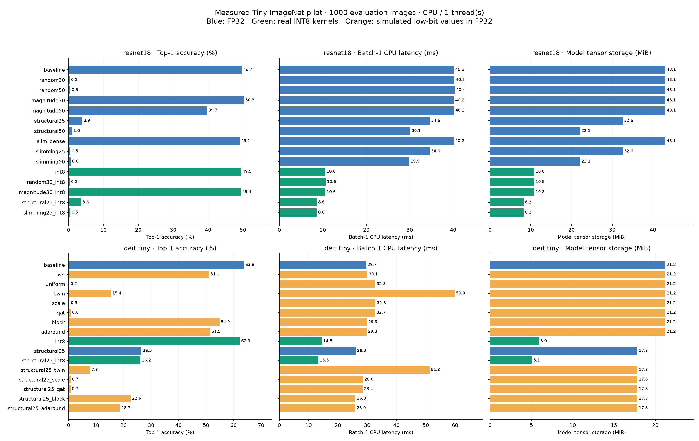
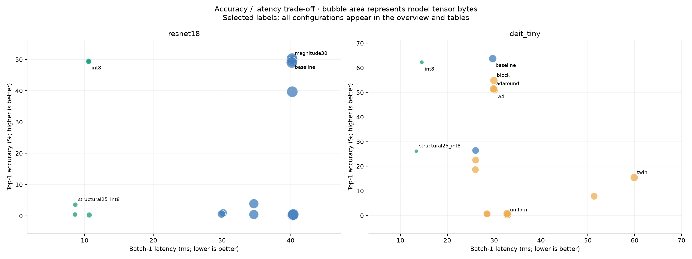
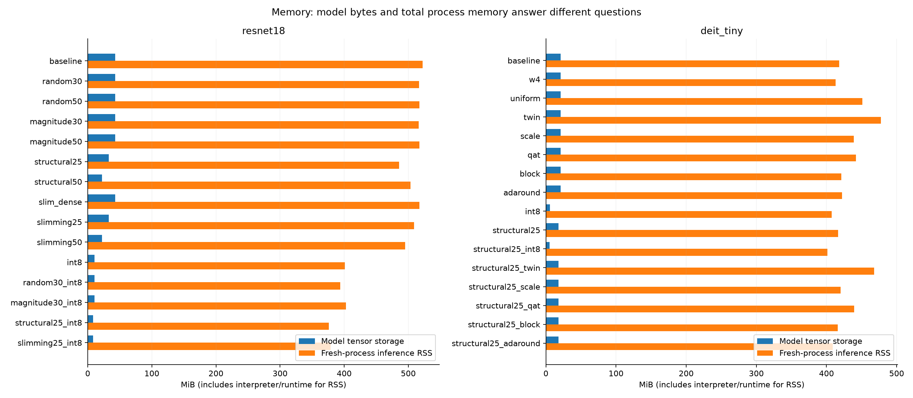
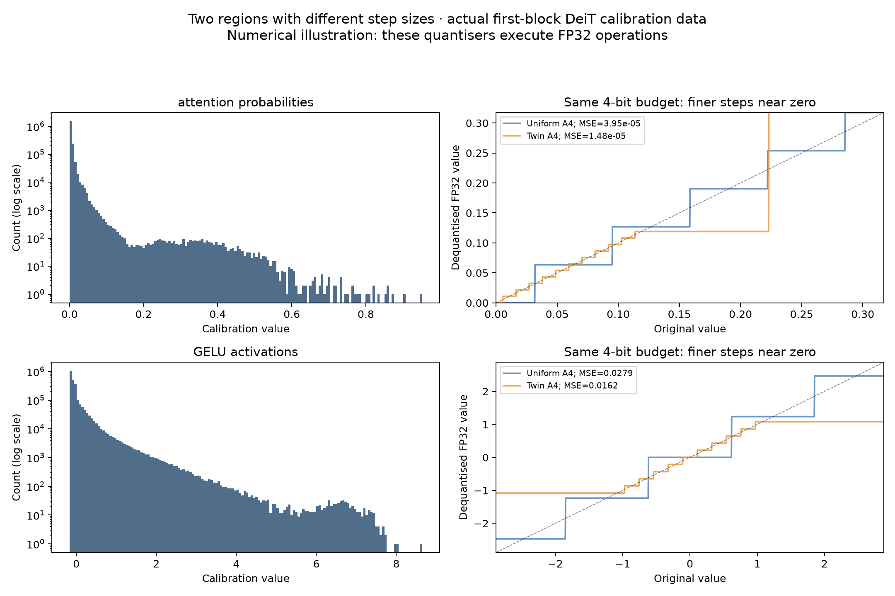

# Measured pruning and quantisation pilot

1000 fixed evaluation images (5 per class), all 200 Tiny ImageNet classes; 2000 separate training images for a fitted linear head, 200 separate training images for calibration / short adaptation.

**These are measured pilot results, not ImageNet-1k benchmark scores or paper reproductions.** The only downloaded dataset was Tiny ImageNet. Both backbones were pretrained on ImageNet-1k; Tiny ImageNet derives from ImageNet, so prior image exposure cannot be excluded. The reported held-out split is held out from this experiment's head fitting, calibration and fine-tuning, not certified held out from original pretraining.

CPU: AMD EPYC 9654P; 1 intra-op thread(s), batch 1 latency after 10 warmups / 50 repeats; batch 16 throughput measured separately. All models receive identical 224x224 normalised images. Timing excludes image loading and preprocessing. Raw timings, sampled paths, reload checks and software versions are saved alongside this report.

## Results

Positive accuracy change means improvement; speedup >1 means faster than the same model's FP32 baseline. Small differences on this subset may be sampling or timing noise; see descriptive accuracy intervals in CSV.

Matched comparisons: `random30` versus `magnitude30`; `w4` versus `block` / `adaround` (same W4A32 coverage); `uniform` versus `twin` / `scale` / `qat` (same W4 / selected A4 coverage). Comparing W4A32 reconstruction directly against selected-A4 QAT also changes activation precision. A collapse in the naive A4 softmax recipe can dominate the scale and short-QAT comparisons; this is not a ranking of the named papers.

### resnet18

| Experiment | Top-1 % | Top-5 % | Δ top-1 pp | Median ms | p95 ms | Speedup | Tensor MiB | File MiB | Peak RSS MiB | Execution |
|---|---:|---:|---:|---:|---:|---:|---:|---:|---:|---|
| baseline | 49.7 | 75.9 | +0.0 | 40.18 | 40.39 | 1.00× | 43.06 | 43.21 | 522.6 | FP32 |
| random30 | 0.3 | 3.1 | -49.4 | 40.30 | 40.89 | 1.00× | 43.06 | 43.21 | 516.9 | FP32 |
| random50 | 0.5 | 2.6 | -49.2 | 40.35 | 41.11 | 1.00× | 43.06 | 43.21 | 517.5 | FP32 |
| magnitude30 | 50.3 | 74.4 | +0.6 | 40.18 | 40.43 | 1.00× | 43.06 | 43.21 | 516.1 | FP32 |
| magnitude50 | 39.7 | 66.7 | -10.0 | 40.22 | 40.62 | 1.00× | 43.06 | 43.21 | 517.0 | FP32 |
| structural25 | 3.9 | 11.5 | -45.8 | 34.63 | 34.90 | 1.16× | 32.58 | 32.73 | 485.4 | FP32 |
| structural50 | 1.0 | 4.1 | -48.7 | 30.13 | 30.29 | 1.33× | 22.10 | 22.25 | 503.2 | FP32 |
| slim_dense | 49.1 | 73.9 | -0.6 | 40.16 | 40.42 | 1.00× | 43.06 | 43.21 | 517.4 | FP32 |
| slimming25 | 0.5 | 3.0 | -49.2 | 34.62 | 35.02 | 1.16× | 32.58 | 32.73 | 508.7 | FP32 |
| slimming50 | 0.6 | 2.5 | -49.1 | 29.92 | 30.30 | 1.34× | 22.10 | 22.25 | 494.9 | FP32 |
| int8 | 49.5 | 75.6 | -0.2 | 10.57 | 10.68 | 3.80× | 10.84 | 11.00 | 401.3 | real INT8 |
| random30_int8 | 0.3 | 3.0 | -49.4 | 10.65 | 10.79 | 3.77× | 10.84 | 11.01 | 393.9 | real INT8 |
| magnitude30_int8 | 49.4 | 75.1 | -0.3 | 10.59 | 10.63 | 3.79× | 10.84 | 11.01 | 403.0 | real INT8 |
| structural25_int8 | 3.6 | 11.0 | -46.1 | 8.62 | 8.73 | 4.66× | 8.21 | 8.38 | 375.9 | real INT8 |
| slimming25_int8 | 0.5 | 2.7 | -49.2 | 8.61 | 8.78 | 4.67× | 8.21 | 8.38 | 378.7 | real INT8 |

### deit_tiny

| Experiment | Top-1 % | Top-5 % | Δ top-1 pp | Median ms | p95 ms | Speedup | Tensor MiB | File MiB | Peak RSS MiB | Execution |
|---|---:|---:|---:|---:|---:|---:|---:|---:|---:|---|
| baseline | 63.8 | 82.3 | +0.0 | 29.68 | 30.28 | 1.00× | 21.22 | 21.59 | 417.9 | FP32 |
| w4 | 51.1 | 75.5 | -12.7 | 30.05 | 30.65 | 0.99× | 21.22 | 21.58 | 412.8 | FP32 simulation |
| uniform | 0.2 | 2.2 | -63.6 | 32.75 | 33.26 | 0.91× | 21.22 | 21.69 | 451.3 | FP32 simulation |
| twin | 15.4 | 34.9 | -48.4 | 59.88 | 60.75 | 0.50× | 21.22 | 21.70 | 477.7 | FP32 simulation |
| scale | 0.3 | 2.3 | -63.5 | 32.83 | 33.35 | 0.90× | 21.22 | 21.68 | 439.2 | FP32 simulation |
| qat | 0.8 | 2.1 | -63.0 | 32.74 | 33.01 | 0.91× | 21.22 | 21.68 | 442.1 | FP32 simulation |
| block | 54.9 | 78.2 | -8.9 | 29.94 | 30.20 | 0.99× | 21.22 | 21.59 | 420.9 | FP32 simulation |
| adaround | 51.5 | 76.2 | -12.3 | 29.81 | 30.10 | 1.00× | 21.22 | 21.59 | 422.2 | FP32 simulation |
| int8 | 62.3 | 82.5 | -1.5 | 14.53 | 14.66 | 2.04× | 5.92 | 6.40 | 407.6 | real INT8 |
| structural25 | 26.5 | 55.3 | -37.3 | 26.05 | 26.24 | 1.14× | 17.84 | 18.21 | 416.5 | FP32 |
| structural25_int8 | 26.2 | 53.6 | -37.6 | 13.34 | 13.51 | 2.23× | 5.07 | 5.58 | 401.1 | real INT8 |
| structural25_twin | 7.8 | 20.7 | -56.0 | 51.30 | 51.53 | 0.58× | 17.84 | 18.34 | 467.8 | FP32 simulation |
| structural25_scale | 0.7 | 3.0 | -63.1 | 28.56 | 28.78 | 1.04× | 17.84 | 18.32 | 419.9 | FP32 simulation |
| structural25_qat | 0.7 | 2.5 | -63.1 | 28.44 | 28.71 | 1.04× | 17.84 | 18.32 | 439.4 | FP32 simulation |
| structural25_block | 22.6 | 47.7 | -41.2 | 26.02 | 26.16 | 1.14× | 17.84 | 18.22 | 416.3 | FP32 simulation |
| structural25_adaround | 18.7 | 41.9 | -45.1 | 25.97 | 26.17 | 1.14× | 17.84 | 18.23 | 409.1 | FP32 simulation |

## Meeting observations from this run

- **resnet18:** fastest measured variant was `slimming25_int8`: 8.61 ms (4.67× baseline), with 0.5% top-1 versus 49.7% baseline.
- `resnet18/random30` → `magnitude30`: top-1 0.3% → 50.3%; latency 40.30 → 40.18 ms; tensors 43.06 → 43.06 MiB.
- `resnet18/baseline` → `int8`: top-1 49.7% → 49.5%; latency 40.18 → 10.57 ms; tensors 43.06 → 10.84 MiB.
- `resnet18/structural25` → `structural25_int8`: top-1 3.9% → 3.6%; latency 34.63 → 8.62 ms; tensors 32.58 → 8.21 MiB.
- **deit_tiny:** fastest measured variant was `structural25_int8`: 13.34 ms (2.23× baseline), with 26.2% top-1 versus 63.8% baseline.
- `deit_tiny/baseline` → `int8`: top-1 63.8% → 62.3%; latency 29.68 → 14.53 ms; tensors 21.22 → 5.92 MiB.
- `deit_tiny/structural25` → `structural25_int8`: top-1 26.5% → 26.2%; latency 26.05 → 13.34 ms; tensors 17.84 → 5.07 MiB.
- `deit_tiny/uniform` → `twin`: top-1 0.2% → 15.4%; latency 32.75 → 59.88 ms; tensors 21.22 → 21.22 MiB.
- `deit_tiny/w4` → `adaround`: top-1 51.1% → 51.5%; latency 30.05 → 29.81 ms; tensors 21.22 → 21.22 MiB.
- `deit_tiny/w4` → `block`: top-1 51.1% → 54.9%; latency 30.05 → 29.94 ms; tensors 21.22 → 21.22 MiB.
- First-block **attention probabilities** on the plotted calibration batch: uniform A4 MSE 3.95e-05, twin A4 MSE 1.48e-05 (2.68× lower). This is a local numerical comparison, not a model accuracy guarantee.
- First-block **GELU activations** on the plotted calibration batch: uniform A4 MSE 0.0279, twin A4 MSE 0.0162 (1.72× lower). This is a local numerical comparison, not a model accuracy guarantee.

## What each experiment actually implements

- Random / magnitude: global weight masks at 30% and 50%, materialised as dense zero tensors. Sparsity alone does not shrink this executable representation.
- Structural CNN: rank hidden convolution filters by L1 norm; slice conv1 output, BN1, and conv2 input together. Residual widths stay intact. 25% hidden channels does not mean 25% total parameters.
- Network slimming: 20 supervised Adam steps with an L1 penalty on eligible BN scales, then rank those scales and physically shrink hidden channels. `slim_dense` is the adapted pre-pruning control. This short fine-tune cannot reproduce full sparsity training and recovery training from the paper.
- Real INT8: ResNet uses fused convolution/BN/ReLU static PTQ with fbgemm, including quantised residual additions; DeiT uses dynamic INT8 Linear kernels. Other operations can remain FP32. Converted module counts and actual packed state bytes are in CSV.
- ViT nearest W4A32: symmetric per-output-channel linear-weight rounding; patch convolution and other parameters remain FP32.
- Twin: two uniform regions, using 75% of magnitude codes inside 1/8 of the calibrated max. Applied to MLP LN outputs, GELU outputs, and attention probabilities, alongside W4 linear weights. `uniform` uses the same selected A4 coverage with one region. This is a [PTQ4ViT-inspired](https://arxiv.org/abs/2111.12293) demonstration without its Hessian-guided calibration or exact search.
- Scale reparameterisation: channel scales are moved algebraically from LayerNorm into the following Linear, with a numerical equivalence check before rounding. SmoothQuant-style channel equalisation motivated by [RepQ-ViT](https://openaccess.thecvf.com/content/ICCV2023/html/Li_RepQ-ViT_Scale_Reparameterization_for_Post-Training_Quantization_of_Vision_Transformers_ICCV_2023_paper.html); not its complete algorithm. Then the same W4 / selected A4 simulation is applied.
- [Q-ViT-inspired](https://arxiv.org/abs/2210.06707): 20 supervised STE fine-tuning steps on a ViT with W4 / selected A4 simulation. It demonstrates QAT on a transformer; it does not implement Q-ViT's information rectification module, distribution-guided distillation or full training recipe.
- Block reconstruction: quantise each ViT block's Linear weights to W4 and optimise its Linear biases against the original local block outputs. Simple [BRECQ-inspired](https://arxiv.org/abs/2102.05426) MSE correction; not second-order BRECQ.
- Adaptive rounding: optimise per-weight sigmoid rounding decisions against local block output MSE, encourage hard choices, then harden to adjacent grid points. Small [AdaRound-inspired](https://arxiv.org/abs/2004.10568) demonstration, not an optimised paper reproduction.
- Combined experiments: pruning is applied first, then quantisation is calibrated or adapted on that pruned model. CNN combines every pruning family with real INT8. ViT combines physical MLP pruning with each advanced demo and dynamic INT8.

**All W4 and A4 experiments execute FP32 kernels and store FP32 tensors. Their measured latency includes any explicit activation simulation overhead. They make no INT4 speed or memory saving claim.** INT8 files contain real packed weights. Checkpoint MiB includes module metadata; tensor MiB counts state tensors, including packed INT8 weights and scales. Peak RSS is sampled every 2 ms in a fresh process containing only the selected model and one benchmark batch; it includes Python, PyTorch, model and runtime workspaces. It is not allocator-exact peak activation memory. `rss_above_import_mib` is also recorded, but includes model loading and workspace allocations.

## Limits and next useful checks

This is one seed, a small stratified evaluation subset and very short adaptation budgets. No hyperparameters were selected on evaluation images. Pretrained features + a small fitted linear head do not equal a fully trained Tiny ImageNet model. Different backbones have different baselines: compare transformations within each backbone. The supplied Wilson intervals describe finite-sample uncertainty only; a paired multi-seed analysis is needed for small accuracy changes. A longer run should add sparse training/recovery, paired fine-tuning controls for QAT, a separate reconstruction validation split, full evaluation, and multiple seeds. Do not infer pathology performance from this dataset.

Sources: the two supplied guides (see README), [project PR](https://github.com/tile-and-error/imagenet-classification/pull/4), [PTQ4ViT](https://arxiv.org/abs/2111.12293), [RepQ-ViT](https://openaccess.thecvf.com/content/ICCV2023/html/Li_RepQ-ViT_Scale_Reparameterization_for_Post-Training_Quantization_of_Vision_Transformers_ICCV_2023_paper.html), [Q-ViT](https://arxiv.org/abs/2210.06707), [BRECQ](https://arxiv.org/abs/2102.05426), [AdaRound](https://arxiv.org/abs/2004.10568).
